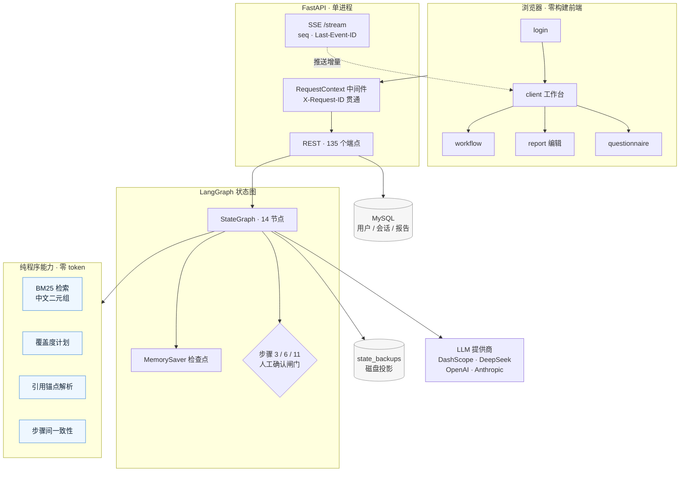
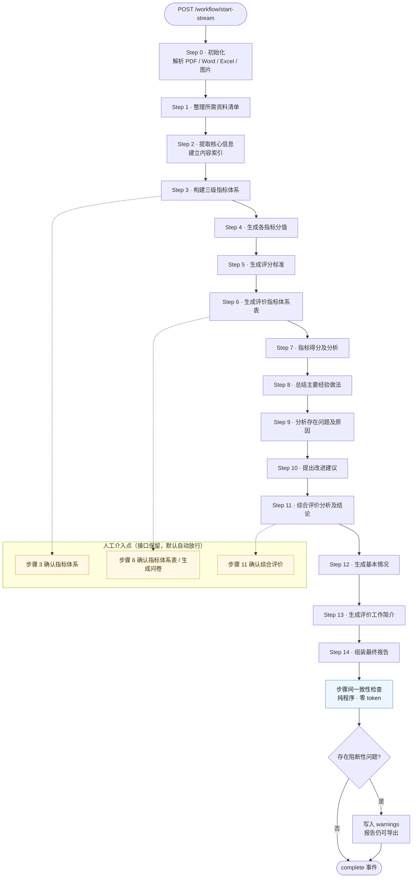
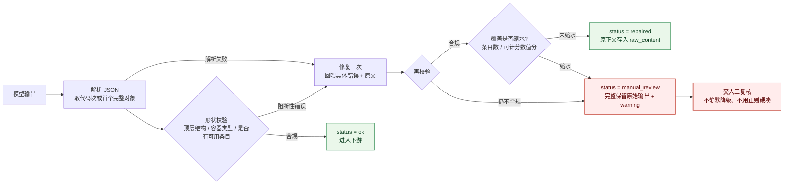
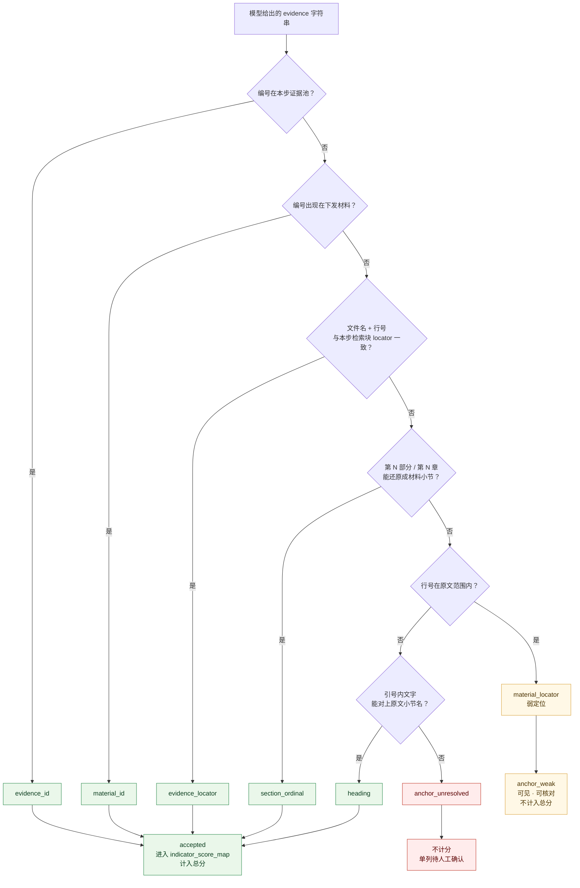
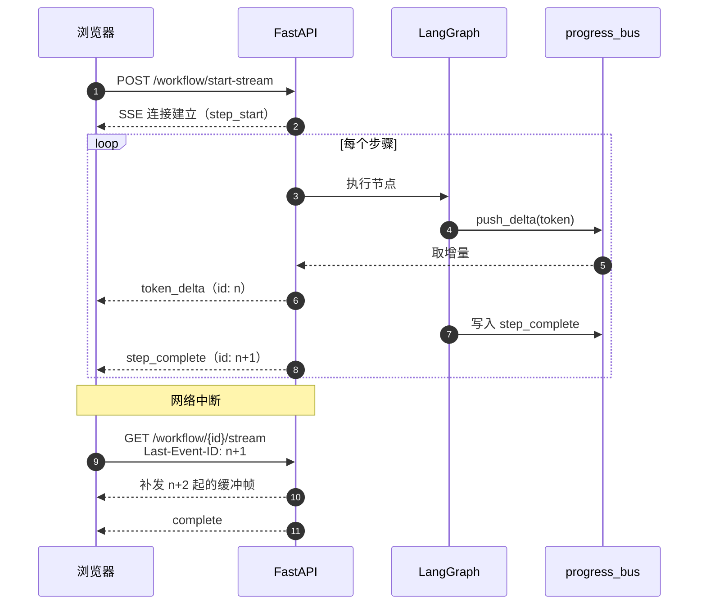

<div align="center">

# 云海睿评 · AI_Grade

**把数周的绩效评价工作，压进一次对话**

基于 LangGraph 的多步 Agent，把财政绩效评价从「读材料、搭指标、逐项打分、写报告」
变成一条可审计、可回滚、可人工接管的流水线。

[](https://www.python.org/)
[](https://fastapi.tiangolo.com/)
[](https://github.com/langchain-ai/langgraph)
[](https://www.mysql.com/)
[](./Dockerfile)
[](#-测试)
[](./LICENSE)
[](./CONTRIBUTING.md)

[快速开始](#-快速开始) · [运行流程](#-14-步工作流) · [API 参考](./docs/API.md) · [贡献指南](./CONTRIBUTING.md) · [安全策略](./SECURITY.md)

</div>

---

## 这是什么

**云海睿评**面向财政、审计、人大等绩效评价场景，覆盖项目支出、部门整体、下级政府运行、
专项债、社保基金等评价类型。上传资料后，系统自动完成资料清单、核心信息提取、
三级指标体系、分值分配、评分标准、逐项评分、问题诊断、改进建议、综合评价，
最终组装成可导出的 Word / PDF 报告。

它不是一个「让模型写一篇报告」的壳子。这个项目真正花力气的地方是：
**把模型输出里不可信的部分标出来，而不是抹平。**

- 每个评分必须能落到原文的某一行、某一段或某条检索证据上，落不到就单列，不进总分；
- 每个 JSON 输出都过形状校验，不合规修一次，修不好交人工，**绝不静默回落成空数据**；
- 同一份材料会声明「总共多少字、实际用了多少、哪些没用到」，而不是假装看完了；
- 每次请求有 `request_id`，报错时把请求号给用户，一行日志定位全链路。

---

## ✨ 核心特性

| 能力 | 说明 |
|------|------|
| **14 步标准化流程** | LangGraph `StateGraph` 编排，步骤间共享类型化状态，每步可单独重跑与人工改写 |
| **三级指标体系** | 6 种指标类型（项目支出 / 部门整体 / 下级政府运行 / 专项债 / 社保基金 / 自定义），类型真实影响生成结果 |
| **可解释的评分落地** | 六类引用锚点 + 七类处置状态；「引用能定位但证据不在本步」单列为弱定位，**不计入总分** |
| **结构化输出兜底** | 形状校验 → 一次修复 → `manual_review`；修复不得缩水，首次正文留档可复盘 |
| **长文档覆盖度** | 带定位符切块、头尾双端预算、覆盖度声明、未引用部分压缩；`used + omitted == total` 可对账 |
| **SSE 实时流** | token 级增量、`seq` 去重、`Last-Event-ID` 断线续传、心跳注释帧 |
| **步骤间一致性** | 纯程序校验（零 token）：分值合计、等级与分数矛盾、正文自述分与程序值不一致等 |
| **真实导出** | Word 由 `python-docx` 生成，PDF 由 `reportlab` 原生排版（含中文），支持字体 / 字号 / 行距 / 页边距定制 |
| **重启可恢复** | 会话落 MySQL + `state_backups/*.json` 磁盘投影，重启后历史报告仍可查看、导出、编辑 |
| **零构建前端** | 原生 HTML/CSS/JS + 共享模块，无 npm、无打包、无 node_modules |

---

## 🏗 架构



设计上刻意把「需要模型的」和「不需要模型的」分开：检索、覆盖度、锚点、一致性全部是
纯程序，可单测、可复现、零 token；模型只负责它真正擅长的生成与判断。

---

## 🔄 14 步工作流



步骤 3 / 6 / 11 在 `StateGraph` 里保留了 `interrupt()` 断点，`/workflow/approve` 接口也在；
当前版本默认全自动跑完，需要人工确认时把闸门打开即可，不必改流程结构。

每一步的产出都会写入 `step_results`，包含正文、`structured_status`、
修复前的 `raw_content`（若有）、以及该步的证据集，支持单步查看、AI 改写与导出。

---

## 🧩 单步内部：结构化校验与修复回路

步骤 3 / 4 / 7 要求模型输出 JSON。这三个步骤走同一条「校验 → 修复 → 兜底」链路：



修复链路本身有两条容易踩的坑，这里都堵上了：

1. **修复提示词不能教模型删条目** —— 原文里「宁可少写条目也不要编造」被实测证明会把
   20 条砍成 5 条；
2. **回喂原文不能被截断** —— 步骤 7 的正常输出可达 12,000 字，旧的 6,000 字上限让模型
   物理上看不见一半指标（实测 11,780 字输入只看得见 11/20 个指标）。

---

## 🎯 步骤 7：评分为什么「落地」或「不落地」

这是整个项目最值得看的一段逻辑。模型写出的引用五花八门，判「对/错」二分会同时冤枉
真实引用和放过假引用，所以这里做的是**分级 + 分状态**：



为什么弱定位不计分？实测某一轮里 4 条「第 1 段」引用中有 3 条的 reason 自己写着
「无法评价，暂按 1.00 分基础分处理」。放行它们会让总分从 30.0 抬到 33.0——
数字更好看，但那是假的。所以给它们一个独立身份：**能看见、可核对、不假装。**

处置台账共 7 类（外加体系外 id 单列），在状态接口与页面徽标上同步展示：

| 状态 | 含义 | 计分 |
|------|------|:----:|
| `accepted` | 引用可定位，条目可用 | ✅ |
| `model_pending` | 模型主动判「资料不足 / 待核实」 | ❌ |
| `anchor_weak` | 引用定位到原文行，但该行未进入本步证据 | ❌ |
| `anchor_unresolved` | 引用无法定位 | ❌ |
| `score_invalid` | 分值不是合法数字（如「很高」） | ❌ |
| `reason_missing` | 缺少评分理由 | ❌ |
| `not_mentioned` | 模型完全没提这个指标 | ❌ |

---

## 📡 实时推送与断线续传



- 每帧带自增 `id`，前端按 id 去重，乱序帧直接丢弃；
- `progress_bus` 缓存最近 400 帧用于补发，心跳用注释帧避免代理超时；
- 进度与增量走**进程内总线**，因此当前仅支持单 worker（多 worker 需替换为 Redis 发布订阅，接口不变）。

---

## ✅ 哪些是程序保证，哪些依赖模型

把这条写进 README，是为了让人知道**哪些结论可以直接引用，哪些必须人工复核**。

**程序保证（有测试或代码强制）**

- 私有资源归属：工作流、报告、问卷、导出文件均按 `user_id` 校验，匿名 401、越权 404；
- 启动幂等：同一 `session_id` 只能登记一次，重复启动 409；
- 评分口径：模型输出须通过 ID / 范围 / 证据校验才进入结构化结果，缺项标「待核实」；
- 引用与证据：证据条目必须逐字出现在原文中，引用必须能落到本步证据池或原文定位；
- 传输协议：SSE 每帧带 `seq`，支持 `Last-Event-ID` 补发，心跳为注释帧；
- 可追溯：每个响应带 `X-Request-ID`，错误体回显 `request_id`，日志第三段即该请求号；
- 导出幂等：同内容同排版 10 分钟内只渲染一次，响应 `reused=true`；
- 结构化输出：不合规修一次，仍不合规则 `manual_review` 且完整保留原文；
- 资料覆盖度：`used_chars + omitted_chars == total_chars`，声明数字与实际送入提示词一致。

**依赖模型自觉（程序只能提示，不能保证正确）**

- 文本事实准确性：金额、时间、产出是否与原始材料一致，只能靠证据引用 + 人工复核；
- 指标设计的专业性：层级与权重是否合理属于领域判断；
- 建议的可行性：程序能检查 `issue_id → suggestion_ids` 的覆盖关系，判断不了建议好不好；
- 打分理由的充分性：程序校验「有没有证据」，不校验「论证是否成立」；
- 长文档覆盖：超长材料仍会截断，尚未实现分块 map-reduce。

**部署语义**

- 进度与 token 增量仅在接住请求的进程内有效，**单 worker**；
- 工作流检查点仍为进程内 `MemorySaver`，进程重启后无法续跑未完成任务
  （已完成步骤与人工编辑可从 MySQL / 磁盘备份恢复）。

---

## 🚀 快速开始

### 方式一：Docker

```bash
cp .env.example .env                  # 填入至少一个 LLM API Key 与 MySQL 连接
docker build -t ai-grade .
docker run -d --name ai-grade -p 8000:8000 --env-file .env ai-grade
```

`.env` 里的 `MYSQL_HOST` 必须是**容器内可达**的地址：Windows / macOS 用
`host.docker.internal`，Linux 可用宿主机内网 IP 或 `--network host`。

访问 <http://localhost:8000>，默认管理员 `admin` / `Admin@123456`（**请立即修改**）。

> 应用当前不依赖 Redis；`docker-entrypoint.sh` 仅在显式配置 `REDIS_URL` 时等待 Redis 就绪。

### 方式二：本地运行

```bash
# 1. 环境：Python 3.9+（Docker 镜像为 3.11）、MySQL 5.7+/8.0
python -m venv .venv
.venv\Scripts\activate          # Windows
# source .venv/bin/activate     # Linux / macOS

pip install -r requirements.txt

# 2. 配置
cp .env.example .env            # 至少填一个 *_API_KEY 与 MySQL 连接

# 3. 建库（表在首次启动时自动创建）
mysql -u root -p -e "CREATE DATABASE IF NOT EXISTS ai_grade_db CHARACTER SET utf8mb4 COLLATE utf8mb4_unicode_ci;"

# 4. 启动
python -m backend.main          # 或 .\start_backend.ps1
```

健康检查：

```bash
curl http://localhost:8000/health
# {"status":"healthy","service":"云海睿评 - AI绩效评价报告生成系统","version":"1.0.0"}
```

### 页面入口

| 页面 | 路径 | 说明 |
|------|------|------|
| 首页 | `/` | 平台介绍与入口 |
| 登录 / 注册 | `/login` | 支持记住登录状态 |
| 客户端 | `/client` | 绩效评价、AI 助手、我的报告、问卷、设置 |
| 管理端 | `/admin` | 用户 / 模型 / 提示词 / 知识库 / 监控 / 审计 |
| 独立工作流 | `/workflow` | 精简版工作流页 |
| 报告编辑 | `/report?session=<id>` | 在线预览与编辑 |
| 问卷填写 | `/questionnaire?session=<id>` | 独立问卷页 |

---

## ⚙️ 配置

完整清单见 [`.env.example`](./.env.example)，关键项：

| 变量 | 说明 | 默认 |
|------|------|------|
| `MYSQL_HOST` / `PORT` / `USER` / `PASSWORD` / `DATABASE` | 数据库连接 | `localhost` / `3306` / `root` / — / `ai_grade_db` |
| `JWT_SECRET_KEY` | Token 签名密钥，**生产必须改** | 占位值 |
| `JWT_ALGORITHM` / `ACCESS_TOKEN_EXPIRE_MINUTES` / `REFRESH_TOKEN_EXPIRE_DAYS` | 令牌策略 | `HS256` / `1440` / `30` |
| `DASHSCOPE_API_KEY` / `DEEPSEEK_API_KEY` / `OPENAI_API_KEY` / `ANTHROPIC_API_KEY` | LLM 密钥（至少一个） | — |
| `DEFAULT_MODEL` | 未显式选择模型时的默认值 | `deepseek-chat` |
| `TEMPERATURE` / `TOP_P` / `MAX_TOKENS` | 生成参数 | `0.7` / `0.9` / `4000` |
| `ALLOWED_ORIGINS` | CORS 白名单（逗号分隔） | `localhost:3000,5173,8000` |

> 模型列表接口只展示**已配置有效密钥**的模型；`your_*` 占位值会被过滤，
> 因此「模型列表为空」通常意味着密钥没填对。

---

## 🗂 项目结构

<details>
<summary>展开目录树</summary>

```
AI_Grade/
├── backend/
│   ├── agents/
│   │   ├── performance_agent.py      # 14 步工作流（LangGraph 编排）
│   │   ├── states/performance_state.py
│   │   ├── tools/
│   │   │   ├── structured_output.py   # JSON 形状校验 + 一次修复 + 缩水闸门
│   │   │   ├── content_indexer.py     # 内容索引
│   │   │   ├── score_validator.py     # 四维校验
│   │   │   └── export_service.py      # Word / PDF 导出
│   │   └── prompts/                   # 提示词（DB 优先，内置兜底）
│   ├── routes/                        # agent / auth / client / admin（135 个端点）
│   ├── services/
│   │   ├── evidence_anchor.py         # 六类引用锚点
│   │   ├── retrieval.py               # BM25 + 中文二元组
│   │   ├── doc_coverage.py            # 长文档覆盖度
│   │   ├── consistency.py             # 步骤间一致性
│   │   ├── progress_bus.py            # 进程内进度总线
│   │   └── export_cache.py            # 导出幂等缓存
│   ├── middleware/                    # 认证 / request_id / 限流
│   ├── models/  utils/  config.py  database.py  main.py
├── frontend/                          # 零构建：原生 HTML/CSS/JS
│   ├── shared/                        # config / api / store / ui / workflow-controller
│   ├── client/  admin/  workflow/  report/  questionnaire/  login/
├── tests/                             # pytest + node:test，268 项
│   └── rag_eval/                      # 检索评估基线（语料 + 样本 + 阈值）
├── docs/API.md                        # 完整接口参考
├── Dockerfile  docker-entrypoint.sh
├── requirements.txt  start_backend.bat  start_backend.ps1
└── wf_e2e.py  frontend_e2e_check.py   # 端到端验证脚本
```

</details>

---

## 🧪 测试

```bash
# Python 单测 + 回归（无需服务器、无需 LLM）
.venv/Scripts/python -m pytest tests/ -q --ignore=tests/rag_eval    # 268 passed

# 前端共享层 / SSE 协议（node:test，无需服务器）
node --test tests/test_shared_frontend.cjs tests/test_workflow_sse.cjs \
            tests/test_client_modules.cjs tests/test_error_routing.cjs \
            tests/test_score_disposition_badge.cjs

# 检索效果基线（无需服务器、无需 LLM）
.venv/Scripts/python -m tests.rag_eval.run --check    # 低于 baseline.json 则退出码 1
```

需要真实模型的验证：

```bash
.venv/Scripts/python frontend_e2e_check.py   # 前端联通性（72 项）
.venv/Scripts/python wf_e2e.py               # 真实 14 步端到端（47 项，约 4~5 分钟）
.venv/Scripts/python verify_coverage_live.py # 4.2 万字长文档覆盖度验证
```

检索基线现状：Recall@3 = **0.448**、MRR = **0.391**、精确率 = **0.161**
（语料 7 份 / 271 块 / 9,925 字，样本 29 条）。改检索前后各跑一次，用数字说话。

> 本机若配置了 HTTP 代理，调用本地服务的脚本需加 `NO_PROXY=127.0.0.1,localhost`。

---

## 🐳 部署注意

- **单 worker**：进度总线与检查点都在进程内，`uvicorn --workers N` 会拆散状态，
  N>1 前请先把 `progress_bus` 与 `MemorySaver` 换成 Redis / Postgres 实现；
- **反向代理**：SSE 需要 `proxy_buffering off;` 与较长的 `proxy_read_timeout`，
  服务端已设置 `X-Accel-Buffering: no`；
- **数据保留**：上传文件默认保留 90 天，每日 03:00 自动清理，可在管理端预览与手动执行；
- **备份**：除 MySQL 外，`state_backups/*.json` 是重启恢复报告的唯一来源，务必一并备份。

---

## 🗺 Roadmap

- [ ] 分块 map-reduce，支持超长材料的真正全覆盖
- [ ] Redis 发布订阅 + 可插拔 checkpointer，支持多 worker 与真续跑
- [ ] `critique-revise` 双模型互评，多模型对比从「并列展示」升级为「择优」
- [ ] `issue_id → suggestion_ids` 的强制覆盖闸门
- [ ] `/metrics` 与结构化日志，补齐可观测性
- [ ] CI（lint + pytest + node:test）与依赖锁定

---

## 🤝 参与贡献

欢迎提 Issue 与 PR。开始之前请先读 [CONTRIBUTING.md](./CONTRIBUTING.md)，
参与本项目即表示同意遵守 [CODE_OF_CONDUCT.md](./CODE_OF_CONDUCT.md)。

安全漏洞请勿公开提 Issue，按 [SECURITY.md](./SECURITY.md) 的方式私下报告。

## 📄 许可证

本项目采用 [MIT License](./LICENSE)。

---

<div align="center">
<sub>如果这个项目对你有帮助，欢迎点一个 ⭐</sub>
</div>
