<div align="center">

# Yunhai Ruiping · AI_Grade

**Weeks of performance-evaluation paperwork, compressed into one conversation**

A multi-step LangGraph agent that turns public-sector performance evaluation — *read the
files, design the indicators, score every item, write the report* — into an auditable,
resumable, human-supervised pipeline.

[](https://www.python.org/)
[](https://fastapi.tiangolo.com/)
[](https://github.com/langchain-ai/langgraph)
[](https://www.mysql.com/)
[](#tests)
[](#tests)
[](https://github.com/Qorq-byte/AI_Grade/actions/workflows/ci.yml)
[](./LICENSE)

[English](./README.md) · [简体中文](./README.zh-CN.md)

[Quick start](#quick-start) · [Runtime flow](#runtime-flow) · [API reference](./docs/API.md) · [Contributing](./CONTRIBUTING.md) · [Security](./SECURITY.md)



<sub>The sweep above is the real execution order — 15 nodes, 3 human gates, and a guardrail layer that never calls a model.</sub>

</div>

---

## What this is

**Yunhai Ruiping** targets performance evaluation in finance, audit and legislative settings:
project expenditure, whole-of-department, sub-national government operations, special-purpose
bonds, social-security funds. Upload the source material and the system produces the document
checklist, core-information extraction, a three-level indicator system, score allocation,
scoring criteria, per-item scores, problem diagnosis, recommendations and a comprehensive
conclusion — assembled into an exportable Word / PDF report.

It is not a wrapper that asks a model to "write a report". The effort here goes into
**marking the untrustworthy parts of the output instead of smoothing them over**:

- every score must land on a specific line, section, or retrieved evidence — otherwise it is
  listed separately and kept **out** of the total;
- every JSON output passes a shape check, gets one repair attempt, and falls back to
  **manual review** — never to a silent empty result;
- every document set declares *how much text it had, how much was actually used, and what was
  left out* — instead of pretending it read everything;
- every request carries a `request_id`, returned to the user on failure, so one log line
  locates the whole chain.

---

## Runtime flow

Fifteen nodes: an initialisation node plus fourteen evaluation steps. Every node writes into a
shared, typed state. Completed steps can be inspected, edited and rolled back; failed steps
can be retried while their in-process checkpoint remains available.

| # | Step | Output |
|:--:|------|--------|
| 0 | Initialise | Parsed PDF / Word / Excel / images, per-file line counts |
| 1 | Required documents | Checklist of what the evaluation needs |
| 2 | Core information | Extracted facts, categorised for later retrieval |
| 3 | Indicator system | Three-level indicators — ◆ human gate |
| 4 | Score allocation | Point budget per indicator |
| 5 | Scoring criteria | What full / partial / zero credit means |
| 6 | Indicator table | The rendered evaluation table — ◆ human gate |
| 7 | Scores & analysis | Per-indicator score + reason + citation anchor |
| 8 | Lessons learned | What worked, with supporting evidence |
| 9 | Problems & causes | Issues, root causes, evidence |
| 10 | Recommendations | Mapped from problem IDs to actions |
| 11 | Comprehensive conclusion | Overall rating — ◆ human gate |
| 12 | Basic information | Project background section |
| 13 | Work profile | How the evaluation was carried out |
| 14 | Final report | Assembled document, consistency-checked |

◆ marks the three `interrupt()` checkpoints. The `/api/agent/workflow/approve` endpoint is wired and the
graph structure supports pausing, but the current build runs straight through by default —
turning a gate on does not require touching the flow.

Each step's result is stored in `step_results` with its body text, `structured_status`, the
pre-repair `raw_content` (if any) and that step's evidence set — so any step can be inspected,
rewritten by the model, or exported individually.

---

## Core capabilities

| Capability | What it does |
|---|---|
| **15-node state graph** | LangGraph `StateGraph`, typed shared state, failed-step retries, manual edits and version rollback |
| **Six indicator types** | Project expenditure / whole-of-department / sub-national government / special bond / social-security fund / custom — the type actually changes generation |
| **Explainable scoring** | Six citation-anchor classes, seven disposition states; an anchor that resolves to a line *not* in this step's evidence becomes weak and is **excluded from the total** |
| **Structured-output fallback** | Shape check → one repair → `manual_review`; a repair may not shrink the result, and the original body is archived |
| **Long-document coverage** | Locator-aware chunking, head/tail budget, coverage statement, compressed summary of unused text; `used + omitted == total` reconciles |
| **SSE streaming** | Per-step content buffers survive navigation; bottom-follow pauses when scrolling up; shared event-ID replay support |
| **Questionnaires** | Open published forms from the whole card without regenerating them; returning restores filters and refreshed statistics |
| **Critique and candidate selection** | Steps 9/10 support critique-revise with a review ledger; compare and adopt model candidates |
| **Cross-step consistency** | Pure program, zero tokens: score totals, rating-vs-score contradictions, self-reported scores that disagree with computed ones |
| **Real export** | Word via `python-docx`, PDF via `reportlab` with native CJK; font, size, spacing and margin options |
| **Restart-safe** | Session in MySQL plus a `state_backups/*.json` disk projection — past reports stay viewable, exportable, editable |
| **No build step** | Plain HTML/CSS/JS with shared modules: no npm, no bundler, no `node_modules` |

---

## What the program guarantees — and what it does not

This distinction is in the README so a reader knows which claims can be cited and which must be
reviewed by a human.

**Program-guaranteed (enforced by code, covered by tests)**

- Resource ownership: workflows, reports, questionnaires and exports are checked against
  `user_id` — anonymous gets 401, cross-user gets 404;
- Idempotent start: one `session_id` registers once, a repeat start returns 409;
- Scoring discipline: model output must pass ID / range / evidence checks before entering the
  structured result; anything missing is marked pending;
- Evidence integrity: an evidence item must appear verbatim in the source; a citation must
  resolve to this step's evidence pool or a locator in the source;
- Transport: SSE data frames carry an increasing `id`, `Last-Event-ID` supports replay, and heartbeats are comment
  frames;
- Traceability: every response carries `X-Request-ID`, error bodies echo `request_id`, and the
  third log segment is that ID;
- Export idempotency: identical content and layout render once per 10 minutes, `reused=true`;
- Structured output: one repair, otherwise `manual_review` with the original text preserved;
- Coverage arithmetic: `used_chars + omitted_chars == total_chars`, and the declared numbers
  match what was actually put into the prompt.

**Model-dependent (the program can flag, not guarantee)**

- Factual accuracy of prose: amounts, dates and outputs match the source only through evidence
  citation plus human review;
- Professional judgement in indicator design: levels and weights are domain calls;
- Feasibility of recommendations: the program flags low-score indicators missing from problems or
  recommendations, but cannot assess whether the advice is sound;
- Sufficiency of scoring rationale: the program checks that evidence exists, not that the
  argument holds;
- Full coverage of very long documents: beyond the budget, text is still truncated —
  map-reduce is not implemented.

**Deployment semantics**

- Progress and token deltas live inside the process that accepted the request — **single
  worker**;
- Checkpoints are an in-process `MemorySaver`: an unfinished run cannot be resumed after a
  restart (completed steps and manual edits are recovered from MySQL / the disk projection).

---

## Structured output: validate → repair → manual review

Steps 3, 4 and 7 require JSON. All three share one path:

1. **Parse** the code block, or the first complete object, out of the model response.
2. **Shape-check** the top-level structure, container types and whether any usable entry exists.
3. **Repair once**, feeding back the specific error plus the original body — never "make it
   shorter".
4. **Shrink gate**: the repaired version must not contain fewer entries, nor fewer numeric
   scores, than the original. A repair that shrinks is rejected and the original is kept for
   manual review.
5. **Manual review** otherwise: the full original output is preserved with a warning. No regex
   improvisation, no silent empty result.

Two failure modes were measured and closed here, because both were real:

- A repair prompt that told the model "rather write fewer entries than invent one" was observed
  cutting 20 entries down to 5 — the instruction now forbids dropping anything;
- Echoing the original body back was capped at 6,000 characters, so a normal ~12,000-character
  step-7 output let the model see only 11 of 20 indicators. The cap is now per-step, and the
  shrink gate compares against the original JSON rather than against body length: one real
  case went 12,608 → 2,745 characters with all 26 entries and all 6 scores intact.

---

## Scoring: why a score lands or does not

Model-written citations are extremely varied, and a binary accept/reject would both reject valid
citations and admit fabricated ones. So resolution is graded, and disposition is recorded per
indicator:

| Anchor class | Resolves against | Disposition |
|---|---|---|
| `evidence_id` | this step's evidence pool | `accepted` — counted |
| `material_id` | an ID issued in the prompt | `accepted` — counted |
| `evidence_locator` | file name + line number from retrieval | `accepted` — counted |
| `section_ordinal` | "part N / chapter N" mapped back to the source | `accepted` — counted |
| `heading` | quoted heading text found in the source | `accepted` — counted |
| `material_locator` | a line number inside the source, but not in this step's evidence | `anchor_weak` — visible, **not counted** |

| Disposition | Meaning | Counted |
|---|---|:--:|
| `accepted` | Citation resolves, entry usable | ✅ |
| `model_pending` | Model itself says "insufficient material / to be verified" | ❌ |
| `anchor_weak` | Resolves to a source line that is not in this step's evidence | ❌ |
| `anchor_unresolved` | Citation cannot be resolved at all | ❌ |
| `score_invalid` | Score is not a legal number (e.g. "very high") | ❌ |
| `reason_missing` | No scoring rationale | ❌ |
| `not_mentioned` | Model never mentioned this indicator | ❌ |

Why keep weak anchors out of the total? In one measured run, 3 of 4 "paragraph 1" citations
carried the model's own reason "cannot evaluate, provisionally scored at the 1.00 baseline".
Letting them through would have raised the total from 30.0 to 33.0 — a better-looking number
that would have been false. They get their own identity instead: **visible, checkable, not
pretended.**

---

## Streaming and step navigation

- The viewed step is separate from the executing step. Navigation keeps receiving output, and returning to a running step immediately restores all received content.
- Each step has its own buffer and status message. Viewing the executing step follows later steps; manually inspecting another step keeps that selection.
- The content pane follows output when at the bottom or within 24px. Scrolling up pauses following; returning to the bottom resumes it. Reading positions are remembered per step.
- Final content replaces the draft. A new run clears old buffers, and late events from an older session are ignored.
- SSE data frames use increasing `id` values for de-duplication. The in-process `progress_bus` keeps the latest 400 frames; heartbeats are comments.
- The shared controller supports replay through `GET /api/agent/workflow/{session_id}/stream` and `Last-Event-ID`. After the client's startup connection drops, status polling recovers progress, normally every 5 seconds.
- A resumed connection does not continuously receive new `token_delta` events. Final bodies are recovered through `step_complete` or the status endpoint. In-page buffers do not guarantee recovery of all unfinished token history after a browser refresh.
- Progress and deltas remain in-process: deploy with one worker.

---

## Quick start

### Docker

```bash
cp .env.example .env                  # at minimum: one LLM API key + MySQL connection
docker build -t ai-grade .
docker run -d --name ai-grade -p 8000:8000 --env-file .env ai-grade
```

`MYSQL_HOST` in `.env` must be reachable **from inside the container**: use
`host.docker.internal` on Windows / macOS, or the host's LAN IP (or `--network host`) on Linux.

Open <http://localhost:8000>. Default administrator is `admin` / `Admin@123456` — **change it
immediately**.

> The app does not need Redis today; `docker-entrypoint.sh` only waits for Redis when
> `REDIS_URL` is explicitly set.

### Local

Use **Python 3.13** to match CI and MySQL 8.0. The Dockerfile currently declares Python 3.11; dependency files are the source of truth. Node.js 22 is only needed for frontend tests, not for serving the app.

Clone the repository, then create an environment for your platform:

```bash
git clone https://github.com/Qorq-byte/AI_Grade.git
cd AI_Grade
```

Windows PowerShell:

```powershell
python -m venv .venv
.\.venv\Scripts\Activate.ps1
python -m pip install -r requirements.txt
Copy-Item .env.example .env
```

Linux / macOS:

```bash
python3 -m venv .venv
source .venv/bin/activate
python -m pip install -r requirements.txt
cp .env.example .env
```

Edit `.env`: set the MySQL connection, `JWT_SECRET_KEY`, and at least one valid model API key. Generate a JWT secret with `python -c "import secrets; print(secrets.token_hex(32))"`. Create the database and start the service; tables are created on first startup:

```bash
mysql -u root -p -e "CREATE DATABASE IF NOT EXISTS ai_grade_db CHARACTER SET utf8mb4 COLLATE utf8mb4_unicode_ci;"
python -m backend.main
```

On Windows, `.\start_backend.ps1` or `start_backend.bat` is also available after configuration. If a moved virtual environment cannot find its original interpreter, recreate it with an available Python and reinstall dependencies; do not commit machine-specific absolute paths.

Open the [client](http://127.0.0.1:8000/client), [admin panel](http://127.0.0.1:8000/admin), or [interactive API docs](http://127.0.0.1:8000/docs). Accounts using the default administrator password must change it before accessing protected features.

Health check (process liveness, not a check that model calls work):

```bash
curl http://127.0.0.1:8000/health
# {"status":"healthy","service":"云海睿评 - AI绩效评价报告生成系统","version":"1.0.0"}
```

### Pages

| Page | Path | Notes |
|------|------|-------|
| Landing | `/` | Product overview and entry points |
| Login / register | `/login` | Supports staying signed in |
| Client workspace | `/client` | Evaluations, assistant, reports, questionnaires, settings |
| Admin | `/admin` | Users, models, prompts, knowledge base, monitoring, audit |
| Standalone workflow | `/workflow` | Minimal workflow page |
| Report editor | `/report?session=<id>` | Preview and edit in place |
| Questionnaire | `/questionnaire?session=<id>` | Standalone form |

---

## Configuration

The full list lives in [`.env.example`](./.env.example); the important ones:

| Variable | Meaning | Default |
|---|---|---|
| `MYSQL_HOST` / `MYSQL_PORT` / `MYSQL_USER` / `MYSQL_PASSWORD` / `MYSQL_DATABASE` | Database connection | `localhost` / `3306` / `root` / — / `ai_grade_db` |
| `JWT_SECRET_KEY` | Token signing key, **must change in production** | placeholder |
| `SECRET_ENCRYPTION_KEY` | Encrypts third-party keys saved in admin; empty means plaintext storage | empty |
| `ACCESS_TOKEN_EXPIRE_MINUTES` / `REFRESH_TOKEN_EXPIRE_DAYS` | Token policy | `1440` / `30` |
| `DASHSCOPE_API_KEY` / `DEEPSEEK_API_KEY` / `OPENAI_API_KEY` / `ANTHROPIC_API_KEY` | LLM keys (at least one) | — |
| `DEFAULT_MODEL` | Model used when none is chosen | `deepseek-chat` |
| `TEMPERATURE` / `TOP_P` / `MAX_TOKENS` | Generation parameters | `0.7` / `0.9` / `4000` |
| `ALLOWED_ORIGINS` | CORS allow-list (comma separated) | `localhost:3000,5173,8000` |

> The model list only shows providers with a **valid configured key**; `your_*` placeholders
> are filtered out. An empty model list almost always means the key is not filled in.

---

## Project layout

<details>
<summary>Expand the tree</summary>

```
AI_Grade/
├── backend/
│   ├── agents/
│   │   ├── performance_agent.py      # 15-node workflow (LangGraph)
│   │   ├── states/performance_state.py
│   │   ├── tools/
│   │   │   ├── structured_output.py   # shape check + one repair + shrink gate
│   │   │   ├── content_indexer.py     # content index
│   │   │   ├── score_validator.py     # four-axis validation
│   │   │   └── export_service.py      # Word / PDF export
│   │   └── prompts/                   # DB first, built-in fallback
│   ├── routes/                        # agent / auth / client / admin + questionnaire / scoring / report / export
│   ├── services/
│   │   ├── evidence_anchor.py         # six citation-anchor classes
│   │   ├── retrieval.py               # BM25 + Chinese bigrams
│   │   ├── doc_coverage.py            # long-document coverage
│   │   ├── consistency.py             # cross-step consistency
│   │   ├── progress_bus.py            # in-process progress bus
│   │   └── export_cache.py            # export idempotency cache
│   ├── middleware/                    # auth / request_id / rate limit
│   ├── models/  utils/  config.py  database.py  main.py
├── frontend/                          # no build: plain HTML/CSS/JS
│   ├── shared/                        # config / api / store / ui / workflow-controller / workflow-steps
│   ├── client/  admin/  workflow/  report/  questionnaire/  login/
├── tests/                             # pytest + node:test (counts below)
│   └── rag_eval/                      # retrieval baseline (corpus + samples + threshold)
├── docs/
│   ├── API.md                         # full API reference (Chinese)
│   └── assets/workflow.svg            # the animated diagram above
├── Dockerfile  docker-entrypoint.sh
├── requirements.txt  requirements-dev.txt  start_backend.bat  start_backend.ps1
└── wf_e2e.py  frontend_e2e_check.py    # end-to-end verification scripts
```

</details>

---

## Tests

As of **2026-11-13**, the local regression run passed **906 Python tests and 71 JavaScript tests**. Separate gstack browse checks replayed SSE and passed 16 interactions at each of 1440×1000 and 1024×768. These browser checks did not call a real model and are not a real-model end-to-end acceptance run. See the [verification log](./progress.md).

### CI and local regression

[GitHub Actions](./.github/workflows/ci.yml) uses Python 3.13, Node.js 22 and pinned `requirements-dev.txt`. Tests use isolated SQLite fixtures, without starting MySQL, a server or a model:

```bash
python -m pip install -r requirements-dev.txt
python -m compileall -q backend
python -m pytest tests -q --ignore=tests/rag_eval
node --test tests/test_*.cjs
```

As in CI, set `MYSQL_HOST=127.0.0.1` and `MYSQL_PORT=1` in the test environment to avoid reaching a real database. `requirements-dev.txt` excludes heavy inference dependencies such as torch and transformers; use `requirements.txt` for the application and optional retrieval features.

Frontend checks include static DOM wiring in `tests/test_frontend_contract.py`, script/state regressions in `tests/test_client_modules.cjs`, and browser interaction checks. Static contracts do not validate layout or scrolling.

### Manual integration and retrieval checks

Start the service on port 8000 for the service scripts below. Some need real MySQL and valid model credentials and will consume tokens:

```bash
python test_all_apis.py
python frontend_e2e_check.py
python wf_e2e.py
python verify_coverage_live.py

# Retrieval baseline: no running server or model calls
python -m tests.rag_eval.run --check
```

Manual questionnaire/workflow browser probes live in `tests/_probe_*.py`; see their browser and login prerequisites. Mutation scripts, `tests/_mutate_*.py`, rewrite source files in place. Run them one at a time in a clean worktree, check `git status --short` afterwards, and do not run them alongside active development edits.

The checked-in [retrieval baseline](./tests/rag_eval/baseline.json), recorded on 2026-11-12, is Recall@3 = **0.5517**, MRR = **0.4828**, precision = **0.2529** (7 documents, 271 chunks, 9,925 characters, 29 samples). These are fixed-corpus results, not an accuracy guarantee for arbitrary materials.

> With an HTTP proxy configured, use `NO_PROXY=127.0.0.1,localhost` for local service calls.

---

## Deployment notes

- **Single worker.** The progress bus and the checkpointer are in-process; `uvicorn --workers N`
  splits the state. Replace `progress_bus` and `MemorySaver` before going above one.
- **Reverse proxy.** SSE needs `proxy_buffering off;` and a long `proxy_read_timeout`; the
  server already sends `X-Accel-Buffering: no`.
- **Data retention.** Uploads are kept 90 days and cleaned at 03:00 daily; the admin page can
  preview and trigger the cleanup.
- **Backups.** Back up MySQL, `state_backups/*.json`, and retained uploads together.
  Disk projections contain workflow state needed to restore historical reports.

---

## Roadmap

- [ ] Chunked map-reduce for genuinely complete coverage of very long documents
- [ ] Redis pub/sub + pluggable checkpointer: multiple workers and real resume
- [x] Step 9/10 `critique-revise`, model-candidate comparison and adoption
- [ ] A hard gate on `issue_id → suggestion_ids` coverage
- [ ] `/metrics` and structured logging
- [x] CI: Python syntax checks, pytest, node:test and pinned test dependencies
- [ ] Add lint to the existing CI

---

## Contributing

Issues and PRs are welcome. Read [CONTRIBUTING.md](./CONTRIBUTING.md) first; participating means
agreeing to the [CODE_OF_CONDUCT.md](./CODE_OF_CONDUCT.md).

Please do not open a public issue for a security problem — report it as described in
[SECURITY.md](./SECURITY.md).

## License

[MIT](./LICENSE).

---

<div align="center">
<sub>If this project is useful to you, a star is appreciated.</sub>
</div>
